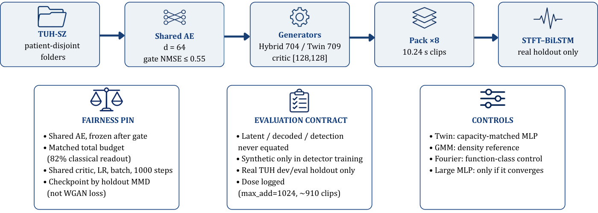
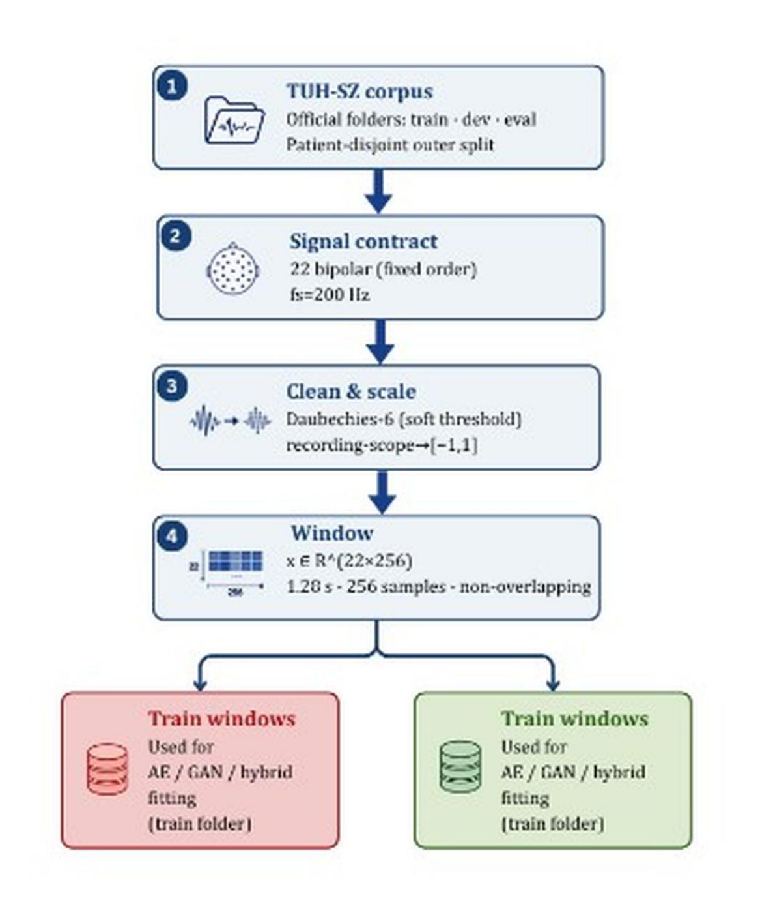
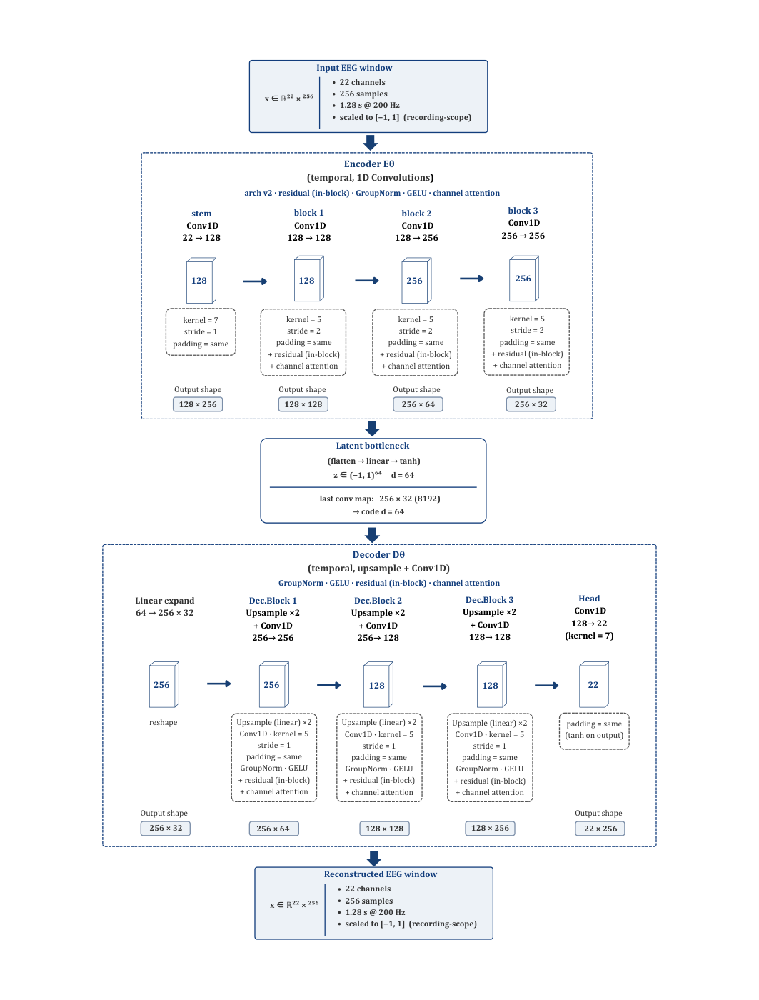
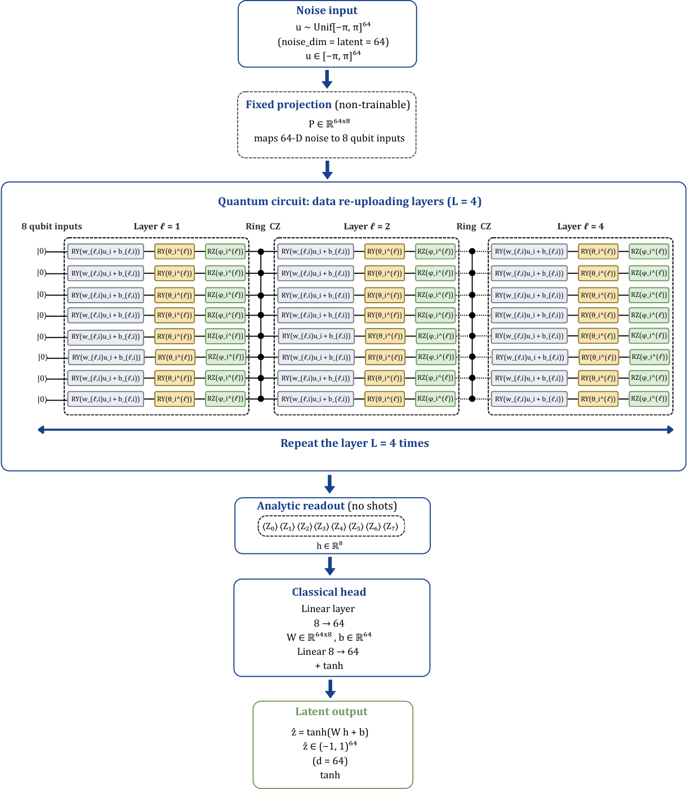
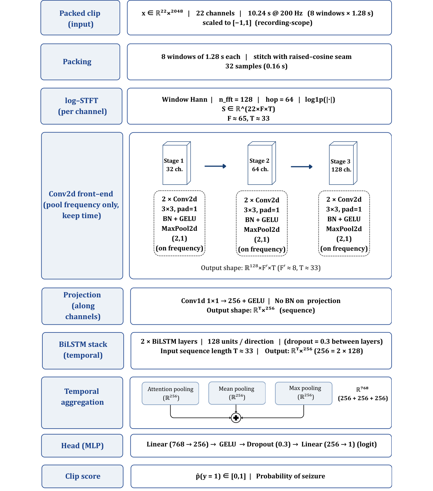
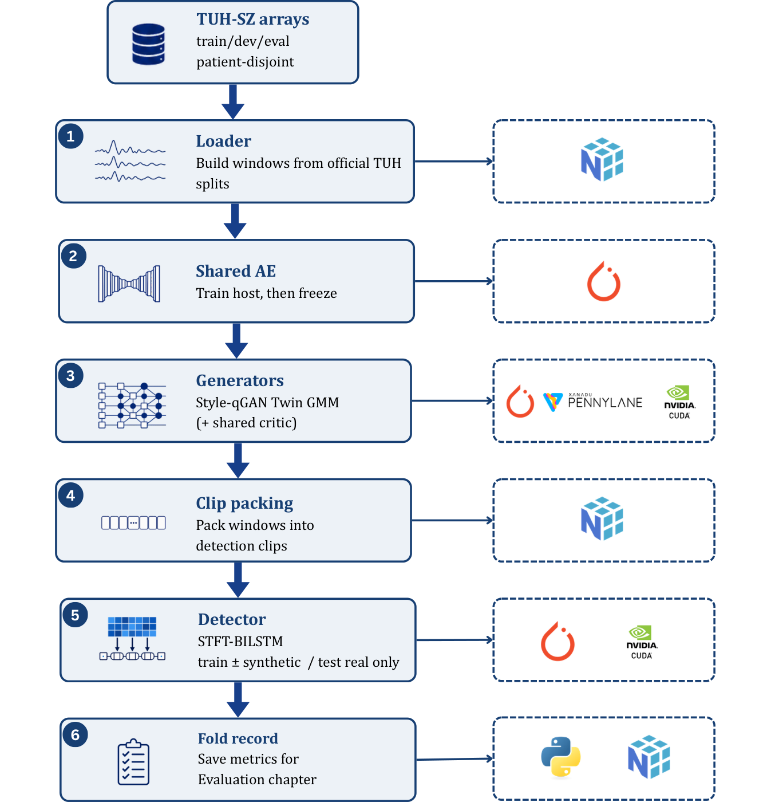

# eeg-qgan

Capacity-matched latent generative models for multichannel seizure EEG.

A hybrid Style-qGAN and classical controls are trained in one latent space, against one critic, at one parameter budget. The code scores three outcomes separately: closeness of the latent codes, structure of the decoded EEG, and seizure detection on real holdout clips. A gain at one level is not reported as a gain at another. The package does not claim a quantum advantage.

The scientific contract is in [docs/PROTOCOL.md](docs/PROTOCOL.md). The figures below are the method plates from the engineering thesis. They describe the system this repository runs.

## Pipeline

Official TUH-SZ folders, a shared autoencoder, generation at 1.28 s, and detection on 10.24 s clips. Synthetic clips may enter training. They do not enter the test set.


## Fairness contract

The comparison is defined before any arm is trained: the same host, the same critic, a matched parameter budget, and three evaluation levels that are never treated as one number.



## What is in this release

| Included | Left out |
| --- | --- |
| The library, the study files, and the tests | TUH recordings |
| The post-audit defaults in `configs/base.yaml` | Trained checkpoints |
| Cluster job templates | Result tables from the thesis campaign |

Thesis numbers were produced by an earlier campaign. They are not reproduced by cloning this repository, and they should not be cited as the output of the corrected protocol until the studies named below have been rerun.

## Install

Python 3.10 or newer.

```bash
git clone https://github.com/MeriemTerki/eeg_qgan.git
cd eeg_qgan
pip install -e ".[dev]"
pytest tests -q
```

On the Narval cluster, once per account:

```bash
bash scripts/narval/setup_env.sh
```

## Run

Every experiment is a YAML file in `configs/studies/` laid over `configs/base.yaml`.

```bash
python scripts/validate_studies.py
python -m eeg_qgan.experiments.runner smoke --data-root data/synthetic --dry-run
python -m eeg_qgan.experiments.runner capacity_rematch --data-root "$DATA_ROOT"
```

`scripts/make_synthetic_dataset.py` builds a small local set for the smoke study. A real run needs the BinaryClassification tree. The path is set in the study or with `--data-root`.

Cluster jobs are generated from the study rather than written by hand:

```bash
python scripts/narval/submit.py capacity_rematch --split-by seed
python scripts/narval/submit.py entanglement_ablation_d8 --split-by seed --dry-run
```

Quantum arms use a CPU state-vector simulator. The autoencoder and the detector are the stages that use a GPU.

### Studies that carry the paper

| Study file | Role |
| --- | --- |
| `capacity_rematch` | Hybrid against the capacity-matched twin |
| `entanglement_ablation_d8` | Product, ring, and fuller circuits at latent width 8, without whitening |
| `downstream_scoped` | Detection on real clips. Refuses to start without patient sidecars |
| `smoke` | Wiring check. Not a result |

Before a patient-wise run:

```bash
python scripts/build_patient_sidecars.py --data-root "$DATA_ROOT" --dry-run
```

The command writes the sidecars or names the missing field. It does not invent groups. The full cluster sequence is in [RUNBOOK.md](RUNBOOK.md).

## Read a finished run

```bash
eeg-qgan-analyze results/capacity_rematch --reference classical_equiv --csv tables/
```

The summary drops folds the autoencoder gate excluded, bootstraps whole folds, and marks a gap smaller than the real-against-real noise floor, an arm that did not converge, and an augmentation dose that collapsed to nothing.

A dependence check that does not retrain:

```bash
python scripts/copula_shuffle_test.py results/capacity_rematch
```

## System

### Preprocessing

Twenty-two bipolar channels at 200 Hz, Daubechies-6 denoising, a robust map to \([-1, 1]\), then non-overlapping windows of 256 samples. Train windows are the only windows the autoencoder and the generators fit.



### Representation

The autoencoder is frozen after the reconstruction gate and shared by every generator. The decoder has no skip connections from the encoder.



### Generator

One re-uploading layer is a data-dependent rotation, two trainable rotations, and the entangling gates of the chosen topology. The circuit is read out by analytic Pauli-Z expectations and expanded by a classical linear map.



### Detector

Eight windows are packed into one 10.24 s clip. The detector reads a spectrogram, not the latent code.



### Code layout



```
eeg_qgan/     library
configs/      base protocol and one YAML file per study
scripts/      checks, plots, patient sidecars, SLURM submission
tests/        splits, MMD bias, gates, preprocessing
demo/         local inference site; weights are not in this repository
docs/         protocol and the figures on this page
```

| Question | Where to read |
| --- | --- |
| What is held fixed, and why | [docs/PROTOCOL.md](docs/PROTOCOL.md) |
| What the previous code got wrong | [AUDIT_FIXES.md](AUDIT_FIXES.md) |
| Which cluster jobs remain | [SUPERVISOR_R_PLAN.md](SUPERVISOR_R_PLAN.md) |
| How to launch them | [RUNBOOK.md](RUNBOOK.md) |
| Where an old script went | [MIGRATION.md](MIGRATION.md) |

## Reproducibility

The random stream of a fold is derived from `(seed, fold, arm)` by a stable hash, so the same fold matches whether it is launched alone or inside a larger job. Each fold is written when it finishes. A requeued job continues from the folds already on disk.

Under `split_mode: predefined` there are two outer folds, `dev` and `eval`. They do not change with the seed. A report that needs five distinct partitions has to use patient sidecars and `grouped_cv`. The summariser prints the number of independent partitions next to the number of rows.

## Citation

A paper is in preparation. Until it is public, cite this repository. GitHub renders [CITATION.cff](CITATION.cff).

```
Terki, M. eeg-qgan: capacity-matched latent generative models for multichannel seizure EEG.
https://github.com/MeriemTerki/eeg_qgan
```
