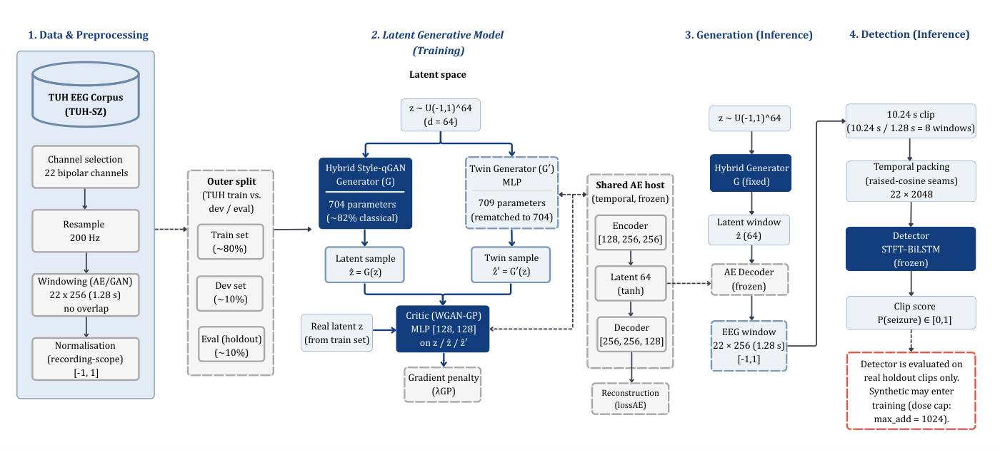
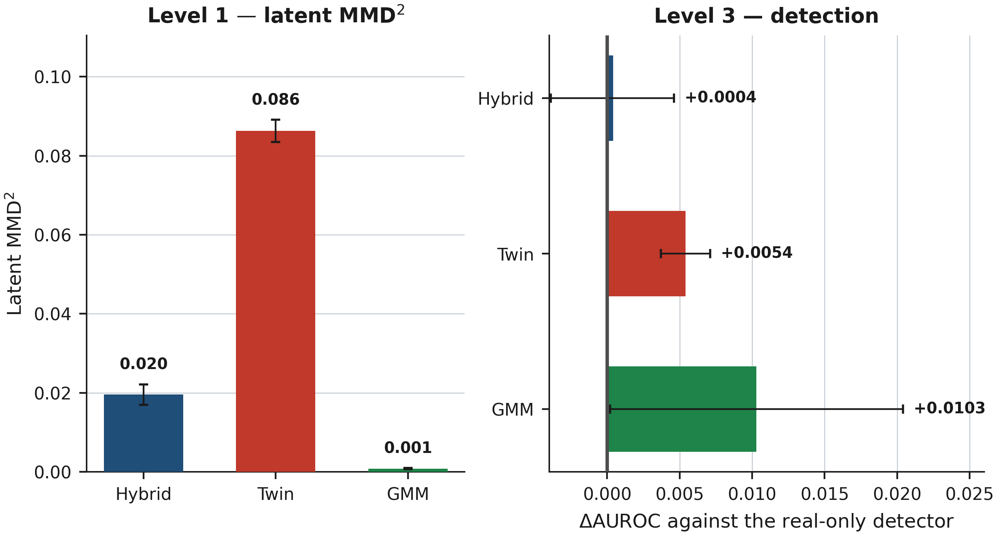

# eeg-qgan

Code for a capacity-matched comparison of latent generators on multichannel seizure EEG.

The generators are trained on windows from the TUH Seizure Corpus. A hybrid Style-qGAN is compared with classical models that use the same autoencoder, the same critic, and, for the twin, the same parameter budget. The repository records latent distance, decoded-signal distance, and detection on real holdout clips.

## Setup

Recordings are resampled to 200 Hz and cut into windows of 22 bipolar channels by 256 samples (1.28 s). A convolutional autoencoder maps each window to a 64-dimensional code and is frozen once reconstruction is acceptable. Every generator is trained in that space.

The hybrid model is an eight-qubit re-uploading circuit followed by a linear map to 64 dimensions (704 parameters, 128 of them in the circuit). The classical twin has 709 parameters. A Gaussian mixture is fit to the real codes and is reported beside the matched pair.

Detection uses a different length. Eight windows are packed into one clip of 10.24 s and passed to an STFT–BiLSTM. Synthetic clips can be added during detector training. The detection scores below are computed on real clips from the official `dev` and `eval` partitions.



## Comparison

The figure shows the same four folds at two stages. On the left, latent MMD² between generated codes and real seizure codes (lower is closer). On the right, the change in AUROC relative to a detector trained on real clips only.



| Model | Parameters | Latent MMD² | AUROC | Change in AUROC |
| --- | ---: | ---: | ---: | ---: |
| Real clips only | — | — | 0.821 ± 0.057 | — |
| Hybrid Style-qGAN | 704 | 0.0158 ± 0.0025 | 0.822 ± 0.052 | +0.0004 |
| Capacity-matched twin | 709 | 0.0883 ± 0.0096 | 0.827 ± 0.059 | +0.005 |
| Gaussian mixture | — | 0.00085 ± 0.00049 | 0.832 ± 0.044 | +0.010 |

Each entry is the mean and standard deviation over four seed-by-fold records. The interval on the hybrid change in AUROC contains zero. Further tables (decoded distances, entanglement, critic width) are in [`results/published`](results/published). The measurement definitions are in [docs/PROTOCOL.md](docs/PROTOCOL.md).

## Installation

Python 3.10 or newer.

```bash
git clone https://github.com/MeriemTerki/eeg_qgan.git
cd eeg_qgan
pip install -e ".[dev]"
pytest tests -q
```

The corpus is not in the repository. Pass its BinaryClassification directory as `--data-root`.

```bash
python -m eeg_qgan.experiments.runner capacity_rematch --data-root "$DATA_ROOT"
```

| Configuration | Purpose |
| --- | --- |
| `capacity_rematch` | Hybrid generator and the matched twin |
| `entanglement_ablation_d8` | Product, ring, and denser circuits |
| `downstream_scoped` | Detector trained with synthetic clips, scored on real clips |
| `smoke` | Short run on a synthetic set |

[docs/REPRODUCING.md](docs/REPRODUCING.md) covers the cluster launch and the summary command.
