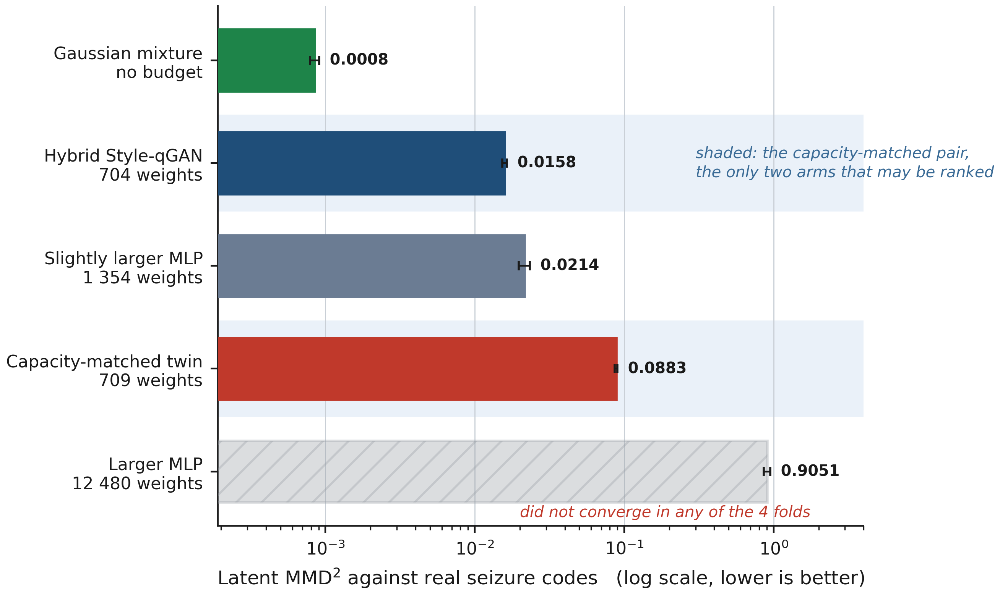
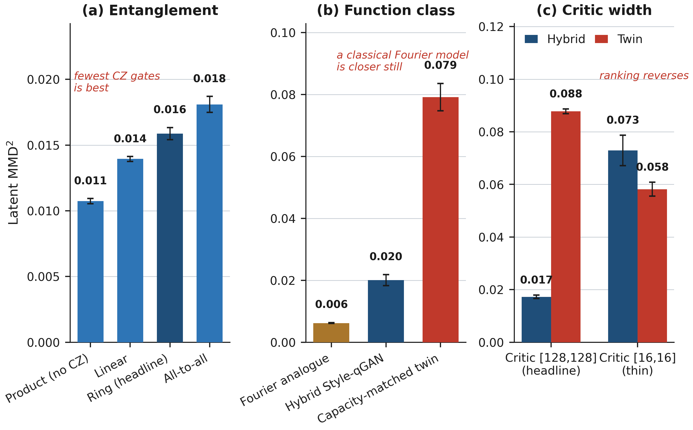

# eeg-qgan

Capacity-matched latent generation for multichannel seizure EEG on TUH-SZ.

A hybrid Style-qGAN and classical generators share one frozen autoencoder, one Wasserstein critic, and one parameter budget. The code reports three outcomes separately: latent MMD², decoded signal distances, and detection on real holdout clips.

## Contribution

The matched comparison is the result. With 704 parameters against 709, the hybrid generator reaches a holdout latent MMD² of 0.016, against 0.088 for the classical twin. Eighty-two percent of the hybrid budget is the classical readout from eight qubits to the 64-dimensional code.

That margin is not a quantum-resource result. Adding entanglement makes the latent distance worse (product 0.011, ring 0.016, full 0.018). A truncated Fourier generator of the same function class is closer than the circuit (MMD² about 0.006). A Gaussian mixture with no critic is closer than either adversarial model (MMD² about 0.0008).

The latent ranking does not transfer to detection. On real holdout clips the real-only AUROC is 0.821. Hybrid augmentation changes it by +0.0004, and the interval contains zero. The twin (+0.005) and the mixture (+0.010) are the arms that move the endpoint. Expectation values are analytic. The repository does not claim a quantum advantage.

## Pipeline

Windows of 1.28 s (22 channels, 256 samples, 200 Hz) are encoded to 64 dimensions, generated, and decoded by the shared autoencoder. Detection packs eight windows into a 10.24 s clip. Synthetic clips may enter training. The reported scores use real holdout clips from the official `dev` and `eval` partitions.


## Results

Tables are in [`results/published`](results/published). Figures below use four seed-by-fold records. Whiskers are cluster-bootstrap intervals.

### Latent rematch

The shaded pair is the only capacity-matched comparison. The hatched bar is a large network that failed to converge, not a capacity result.



| Arm | Parameters | Latent MMD² |
| --- | ---: | ---: |
| Gaussian mixture | — | 0.00085 ± 0.00049 |
| Hybrid Style-qGAN | 704 | 0.0158 ± 0.0025 |
| Capacity-matched twin | 709 | 0.0883 ± 0.0096 |

Full table: [`results/published/latent_rematch.csv`](results/published/latent_rematch.csv).

### Latent rank against detection

The left panel is latent distance. The right panel is the change in AUROC against the real-only detector (0.821). The order of the arms is not the same in the two panels.


| Arm | AUROC | ΔAUROC |
| --- | ---: | ---: |
| Real only | 0.821 ± 0.057 | — |
| Hybrid | 0.822 ± 0.052 | +0.0004 (interval contains 0) |
| Twin | 0.827 ± 0.059 | +0.005 |
| Gaussian mixture | 0.832 ± 0.044 | +0.010 |

[`results/published/detection.csv`](results/published/detection.csv)

### Mechanism

Entanglement, a Fourier control, and critic width. More connectivity worsens MMD². The Fourier model is closer than the circuit. A thin critic reverses the hybrid-versus-twin order.



[`results/published/entanglement.csv`](results/published/entanglement.csv) · [`results/published/critic.csv`](results/published/critic.csv)

Decoded distances, depth, bottleneck, dose, and qubit width are in `docs/figures/decoded.png`, `robustness.png`, `dose_and_scarcity.png`, and `qubit_width.png`. Decoded numbers are in [`results/published/decoded.csv`](results/published/decoded.csv).

## Run

Python 3.10 or newer. TUH-SZ is not included.

```bash
git clone https://github.com/MeriemTerki/eeg_qgan.git
cd eeg_qgan
pip install -e ".[dev]"
pytest tests -q
python -m eeg_qgan.experiments.runner capacity_rematch --data-root "$DATA_ROOT"
```

| Study | Role |
| --- | --- |
| `capacity_rematch` | Hybrid against the matched twin |
| `entanglement_ablation_d8` | Circuit topology |
| `downstream_scoped` | Detection on real clips |
| `smoke` | Local check |

Commands for a cluster run and for reading a finished directory are in [docs/REPRODUCING.md](docs/REPRODUCING.md). The evaluation rules are in [docs/PROTOCOL.md](docs/PROTOCOL.md).

## Layout

```
eeg_qgan/            models, data, training, evaluation
configs/             defaults and one file per study
results/published/   tables for the figures on this page
docs/figures/        pipeline and result plots
scripts/             checks, synthetic data, job submission
tests/
```

## Citation

```
Terki, M. eeg-qgan: capacity-matched latent generative models for multichannel seizure EEG.
https://github.com/MeriemTerki/eeg_qgan
```
